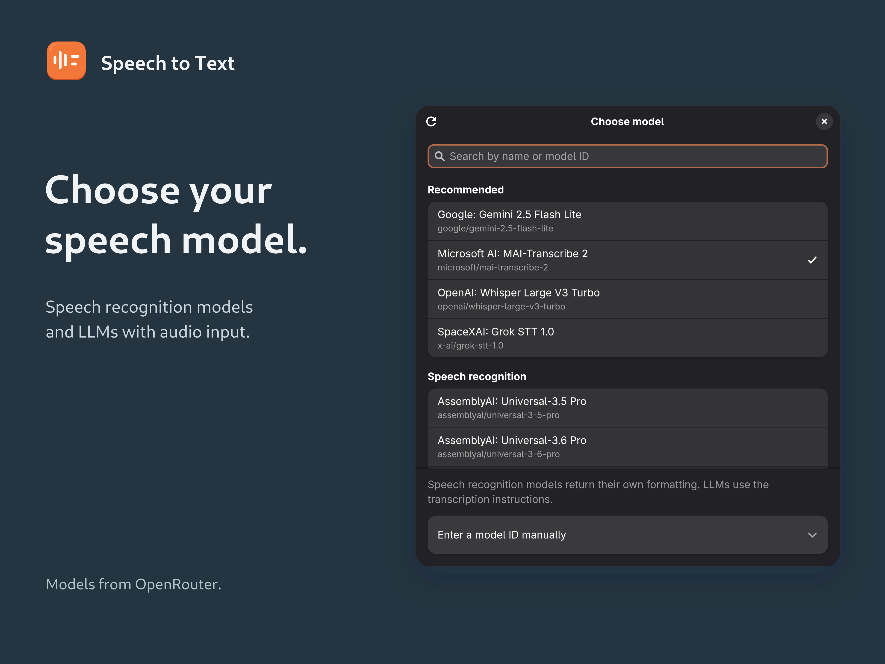
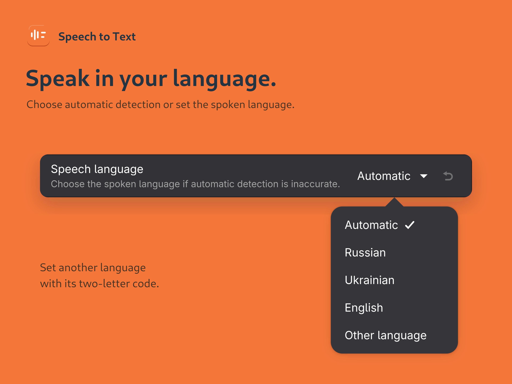

# Speech to Text

Dictation for GNOME Shell using [OpenRouter](https://openrouter.ai/). Start and
stop recording with **Super+Z** or the panel icon. The transcript is copied to the
clipboard and pasted into the focused application, replacing selected editable
text.

[](https://extensions.gnome.org/extension/9978/speech-to-text/)
[](#installation)
[](LICENSE)

Requires GStreamer 1.0 with the base/good plugins and an
[OpenRouter API key](https://openrouter.ai/keys).


## Installation

Install from [GNOME Extensions](https://extensions.gnome.org/extension/9978/speech-to-text/).
For manual installation, download `stt-ego-upload.zip` from
[GitHub Releases](https://github.com/d-kurchenko/gnome-shell-extension-stt/releases):

```sh
gnome-extensions install --force stt-ego-upload.zip
```

After installing or updating, log out and back in on Wayland to load the new
modules. Disabling and re-enabling the extension does not reload them.

```sh
gnome-extensions enable stt@pvmnsdev.gmail.com
gnome-extensions prefs stt@pvmnsdev.gmail.com
```

For a local checkout, see [Development](#development).

## Configuration

Add your OpenRouter API key in preferences.

### Models

The searchable catalog comes from OpenRouter. **MAI-Transcribe 2** is the default.
Two kinds of models are supported:

- **Speech recognition** models return their transcript directly.
- **LLMs with audio input** receive transcription instructions, including writing
  numbers as digits and removing hesitations.

The extension selects the matching API automatically. Manual model IDs and an
API-type override are available for models the catalog cannot resolve.



### Speech language

**Speech language** defaults to automatic detection. Set the spoken language
explicitly if a model misidentifies it, especially on short recordings. Other
languages can be specified with a two-letter ISO-639-1 code.



### Automatic paste

Automatic paste uses **Ctrl+V**, or **Ctrl+Shift+V** for terminal input. Target
applications must support the corresponding paste shortcut. On Wayland,
automatic paste can fail with a non-Latin keyboard layout. The transcript
remains available for manual paste from the clipboard.

## Data handling

Audio is recorded locally and uploaded to OpenRouter when recording stops.
Processing and retention depend on OpenRouter and the selected provider. Your
API key is stored in the extension's GSettings.

The extension writes the transcript to the normal clipboard. It does not read
clipboard history or collect telemetry.

## Development

The extension is written in TypeScript and runs in GJS. Building requires Bun,
GLib tools, gettext, Python 3, and zip.

```sh
bun install --frozen-lockfile
bun run build
bun run install:extension
```

The build is written to `dist/stt@pvmnsdev.gmail.com/`. The install script symlinks
that directory into the user extension directory, replacing any existing local
installation of this extension.

The two entry points are `src/extension.ts` and `src/prefs.ts`. Shell modules live
in `src/lib/`, shared OpenRouter code in `src/openrouter/`, and preferences UI in
`src/prefs/`. Settings are defined in `schemas/`. Shell and preferences run in
separate processes; keep GTK imports in preferences and Shell imports out of it.
Use GJS platform APIs in runtime modules; Bun and Node APIs belong in build tools.

Validation and packaging:

```sh
bun run check
glib-compile-schemas --strict --dry-run schemas
bun run pack
```

`bun run pack` produces `stt-ego-upload.zip` and verifies its contents against the
build. CI runs the same checks. Use `bun run i18n:refresh` after changing
translatable strings.

Builds also regenerate the GNOME compatibility badge from `metadata.json`.
Use `bun run badges:update` to update it separately. Include the generated SVG
when committing changes to `shell-version`; CI checks that it stays in sync.

### Debugging

```sh
journalctl _COMM=gnome-shell --since="5 min ago" --no-pager | grep -E 'Speech to Text|JS ERROR'
```

Bug reports should include the GNOME version, model ID, speech language, target
application, and relevant journal output.

### Releases

Publishing a stable GitHub Release runs the [publish workflow](.github/workflows/publish.yml):
it validates the tagged commit, attaches the ZIP, and submits the same artifact
to extensions.gnome.org for review. Prereleases do not trigger submission.

Configure the `EGO_USERNAME` and `EGO_PASSWORD` repository secrets before
publishing. Submission uses `--accept-tos` for the
[GNOME Extensions upload terms](https://extensions.gnome.org/upload/).

## License

[GPL-2.0-or-later](LICENSE).
